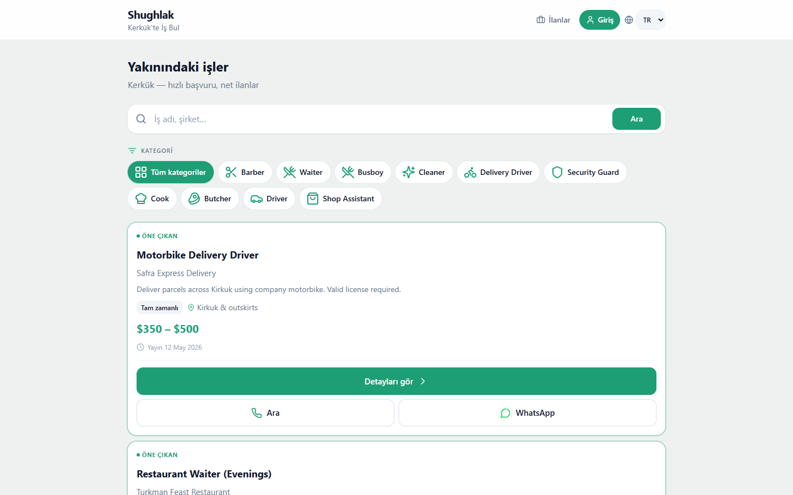

# 💼 Shughlak — Çok Dilli Yerel İş İlanları Platformu



**Shughlak**, Kerkük ve çevresindeki yerel işletmeler ile iş arayanları hızlı, sade ve doğrudan buluşturan çok dilli (Türkçe, Arapça, Kürtçe, İngilizce) bir iş ilanları ve istihdam platformudur. Karmaşık başvuru süreçleri yerine kategori bazlı filtreleme, doğrudan telefon araması ve tek tıkla WhatsApp üzerinden iletişim imkanı sunar.

---

## ✨ Öne Çıkan Özellikler

- **Çoklu Dil Desteği (`next-intl`):** Türkçe, Arapça, Kürtçe ve İngilizce dil seçenekleri ve RTL/LTR uyumlu arayüz.
- **Hızlı Arama ve Kategori Filtreleme:** Kurye, Garson, Berber, Aşçı, Güvenlik Görevlisi, Kasap, Şoför gibi yerel sektör kategorilerine göre anında filtreleme.
- **Doğrudan İletişim:** İlan kartları üzerinden tek tıkla **Telefonla Arama** veya **WhatsApp** mesajı gönderme.
- **Kimlik Doğrulama & İlan Yönetimi (`NextAuth.js`):** İşveren ve yönetici hesapları için güvenli giriş, ilan oluşturma, düzenleme ve öne çıkarma.
- **Modern Veritabanı Mimarisi:** Prisma ORM ve LibSQL / SQLite (Turso uyumlu) altyapısı ile hızlı veri sorgulama.

---

## 🛠️ Kullanılan Teknolojiler

| Kategori | Teknoloji |
| :--- | :--- |
| **Çatı (Framework)** | Next.js 14 (App Router), React 18, TypeScript |
| **Veritabanı & ORM** | Prisma ORM, LibSQL (`@libsql/client`, `@prisma/adapter-libsql`) |
| **Kimlik Doğrulama** | NextAuth.js v4, bcryptjs |
| **Çoklu Dil (i18n)** | next-intl |
| **Stil & İkonlar** | Tailwind CSS, Lucide React |
| **Doğrulama (Validation)** | Zod |

---

## 📂 Proje Klasör Yapısı

```text
shughlak/
├── app/                  # Next.js App Router sayfaları, yerel dil ([locale]) rotaları ve API uç noktaları
├── components/           # Yeniden kullanılabilir UI bileşenleri (ilan kartları, filtreler, üst bar)
├── hooks/                # Özel React hook'ları
├── lib/                  # Prisma istemcisi, kimlik doğrulama ve yardımcı fonksiyonlar
├── messages/             # Çok dilli çeviri dosyaları (tr, ar, ku, en)
├── prisma/               # Veritabanı şeması (schema.prisma) ve başlangıç verileri (seed.ts)
├── public/               # Statik dosyalar ve ekran görüntüleri
│   └── screenshots/
│       └── preview.png   # Uygulama önizleme görseli
├── types/                # TypeScript tip tanımlamaları
├── i18n.ts               # Uluslararasılaştırma yapılandırması
├── middleware.ts         # Dil yönlendirme ve yetki ara katmanı
└── package.json          # Bağımlılıklar ve betikler
```

---

## 🚀 Kurulum ve Çalıştırma

### Gereksinimler

- **Node.js:** `>= 18.x` (veya `20.x` önerilir)
- **npm**

### Adımlar

1. **Depoyu klonlayın:**
   ```bash
   git clone https://github.com/Sermedsefaa/shughlak.git
   cd shughlak
   ```

2. **Bağımlılıkları yükleyin:**
   ```bash
   npm install
   ```

3. **Ortam değişkenlerini yapılandırın:**
   `.env.example` dosyasını `.env` olarak kopyalayın ve gerekli değişkenleri (`DATABASE_URL`, `NEXTAUTH_SECRET`, `NEXTAUTH_URL`) düzenleyin:
   ```bash
   cp .env.example .env
   ```

4. **Veritabanını hazırlayın ve örnek verileri yükleyin:**
   ```bash
   npx prisma generate
   npx prisma db push
   npx prisma db seed
   ```

5. **Geliştirme sunucusunu başlatın:**
   ```bash
   npm run dev
   ```
   Tarayıcınızda `http://localhost:3000` adresini açarak uygulamayı görüntüleyebilirsiniz.

---

## 📄 Lisans

Bu proje eğitim ve portfolyo amaçlı geliştirilmiştir.
